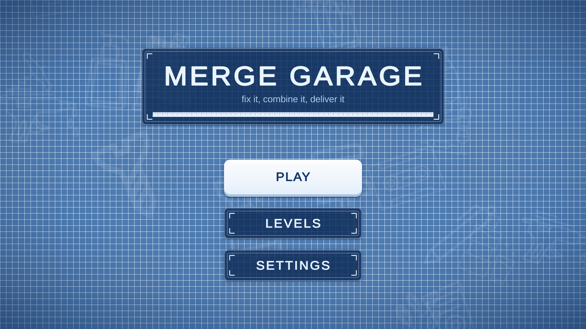
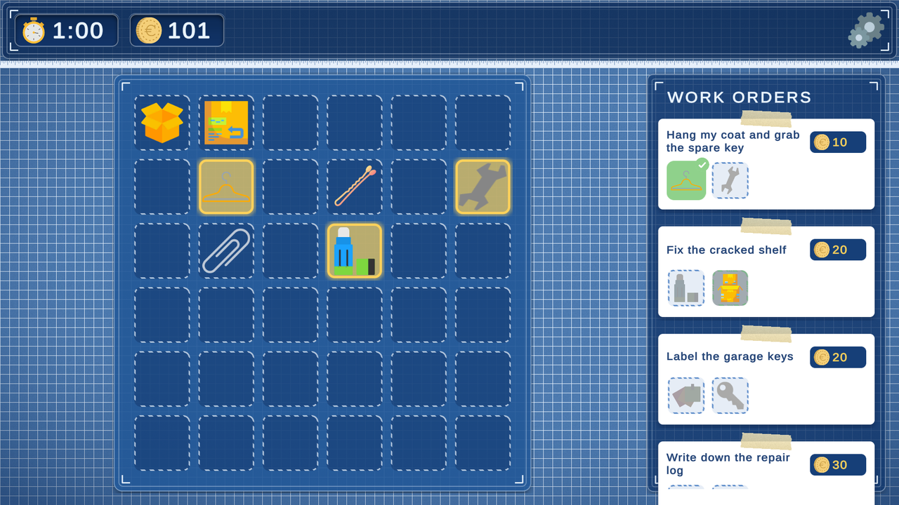
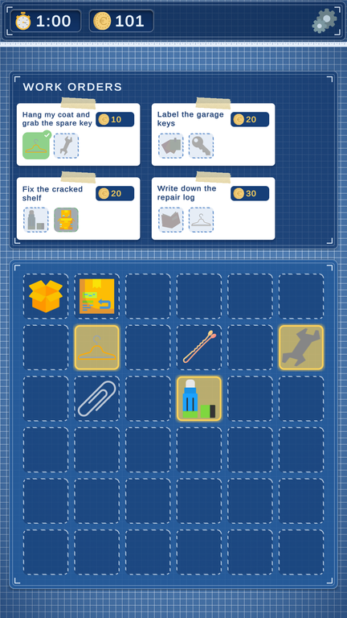

# Merge Garage

A small merge puzzle game made in Unity. Spawn everyday items, combine two of a kind into something better, and deliver what your customers ask for before the clock runs out.



## About the project

Merge Garage was created in 2023 as a university project for a **Game Mechanics** course. In 2026 it got a revamp:

- a new blueprint-style UI that works in both landscape and portrait
- a start scene with level select (levels unlock one by one) and settings
- in-game pause with the same settings panel
- three handcrafted levels with a rising difficulty curve
- visual feedback: delivered items turn green in work orders, and items on the board that an order still needs are highlighted in yellow
- an audio system with music and sound effect volume controls
- bug fixes and an upgrade to Unity 2022.3 LTS



## How to play

1. **Click a spawner** (the boxes on the board) to put a basic item into a free slot.
2. **Drag an item onto an identical one** to merge them into the next item in its chain.
3. **Drag the right item onto a work order** to deliver it. When an order is complete you get its coin reward.
4. Some orders give a **new spawner** as a reward. Drag it out of the order onto the board to unlock a new item chain.
5. Complete all orders before the timer runs out. Time left over is added as a bonus.

### Merge chains

| Spawner | Chain |
|---|---|
| Office | pin → paper clip → hanger → glue → office tape → tape → duct tape → stapler |
| Keys | key → key 2 → key 3 → saw → saw 2 |
| Paper | toilet paper → sticky notes → newspaper → notebook → book |
| Wiring | wire → bulb → pill → battery → poison → soda → coffee → compass |

### Levels

| Level | Name | Orders | Time | What's new |
|---|---|---|---|---|
| 1 | First day at the garage | 3 | 3:00 | Two spawners, short chains |
| 2 | New deliveries | 4 | 3:00 | An order unlocks the paper spawner |
| 3 | Rush hour | 4 | 3:20 | Two unlockable spawners, longer chains |



## Getting started

- **Unity version:** 2022.3.62f3 (LTS)
- Open the project folder in Unity Hub and start from `Assets/Scenes/Menu.unity`.
- Build order: `Menu`, `Level 1`, `Level 2`, `Level 3` (File → Build Settings).

### Audio

The game doesn't ship with sounds. To add your own, open `Assets/Resources/AudioManager.prefab` and assign clips to its slots (music, click, spawn, merge, error, quest done, win, lose). Empty slots are simply silent. The audio manager is created automatically in every scene, so levels can also be played directly from the editor.

### Saved data

Level progress and settings are stored in `PlayerPrefs`. To reset them in the editor use **Edit → Clear All PlayerPrefs**.

## Project structure

```
Assets/
├── Prefabs/            items, spawners and base UI prefabs
├── Resources/          AudioManager prefab (assign audio clips here)
├── Scenes/             Menu, Level 1–3
├── Scripts/
│   ├── Audio/          AudioManager, button click sounds
│   ├── Board/          draggable items, slots, spawners, item types
│   ├── Core/           level flow, timer, progress, session
│   ├── EventSystem/    ScriptableObject game events
│   ├── Menu/           main menu and level select
│   ├── Quests/         work orders and reward slots
│   ├── Settings/       persisted settings and the settings panel
│   └── UI/             HUD, responsive layout, end and pause screens
├── Textures/           item icons and UI sprites
└── GameEvents/         event assets (currency, timer)
```
